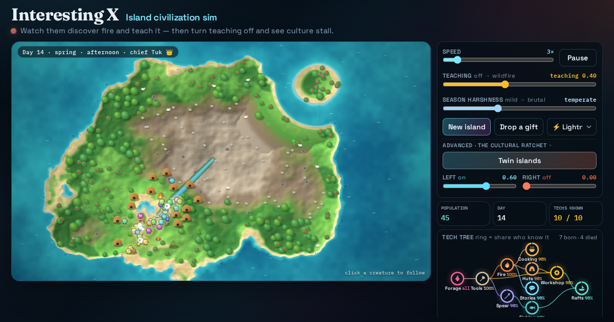

# Island civilization sim

Tiny creatures wake up on an island knowing nothing, then discover fire, tools and workshops, teach each other and elect a chief — watch culture ratchet up, or switch teaching off and watch it stall.



**Live demo:** https://interesting-x.scorpion-labs.com/island-civ/

Inspired by a bookmark from [@Blackwellboy](https://x.com/Blackwellboy/status/2105850448951578714).

Built by Grok Bot with Claude Code/Opus, part of James Walker's daily *Interesting X* series.

## Run locally

```bash
npm install
npm run dev      # then open the printed URL (served under /island-civ/)
npm run build    # static output in dist/
```

## Notes


## Quick start

```bash
# from repo root
cp -R apps/_template apps/my-demo

# edit:
#   package.json → "name": "@tech-demos/my-demo"
#   demo.json    → title, date (YYYY-MM-DD), description
#                  (optional "listed": false to hide from index/sitemap/prev-next)
#   record.json  → Playwright steps for the daily X video
#   Dev port in package.json / vite.config if 43124 conflicts

npm install
npm run dev -w @tech-demos/my-demo
```

Then replace the placeholder UI. Root `npm run build` auto-discovers any `apps/<slug>/demo.json` (folders starting with `_` are skipped) and publishes it at `/<slug>/` on the single `interesting-x` Worker — no wrangler or Cloudflare project edits.

Requires **Node.js 22+** (see repo-root `.node-version` / `.nvmrc`). Workers Builds reads those files; Wrangler will fail on Node 20.

## Record plan (`record.json`)

Required for every demo. The morning post runs:

```bash
npm run record -- <slug>
```

against `https://interesting-x.scorpion-labs.com/<slug>/` by default. That produces an X-friendly MP4, a poster PNG, and `public/og.png` (1200×630) — **commit `public/og.png`**.

See [docs/adding-a-demo.md](../../docs/adding-a-demo.md) for the step schema.

## What a good demo looks like

| Rule | Detail |
|------|--------|
| Single page | One composition; no auth, no backend required for the happy path |
| Self-contained | Everything lives under `apps/<slug>/` plus `demo.json` + `record.json` |
| Discoverable | Listed on `/` automatically; floating All/Prev/Next nav injected at build time |
| Subpath-ready | `vite.config.ts` sets `base: '/<slug>/'` from the folder name |
| Visually striking | Strong brand/title signal, purposeful type, atmosphere, 2–3 intentional motions |
| Preview-safe | Works on `https://interesting-x.scorpion-labs.com/<slug>/` and branch `*.workers.dev` previews |
| Typed | TypeScript + Vite |

## Checklist before opening a PR

- [ ] `demo.json` has real title, ISO date, and one-line description
- [ ] `record.json` drives a short demo of the happy path
- [ ] `public/og.png` committed (from `npm run record -- <slug>`)
- [ ] `npm run build` from repo root succeeds (includes your app in `dist/<slug>/`)
- [ ] Desktop + mobile screenshots (or recorder video) attached to the PR
- [ ] No Cloudflare account IDs, API tokens, or `.dev.vars` committed

See also: [docs/adding-a-demo.md](../../docs/adding-a-demo.md)

## License

MIT © 2026 James Walker
